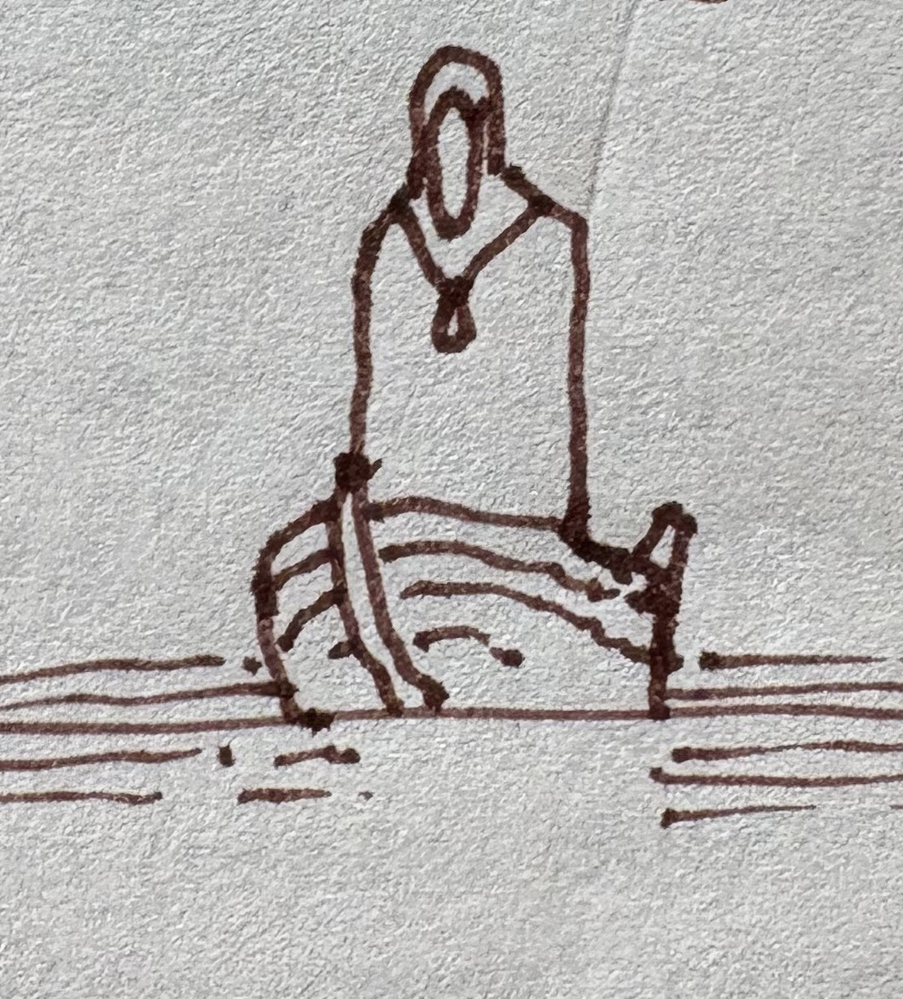
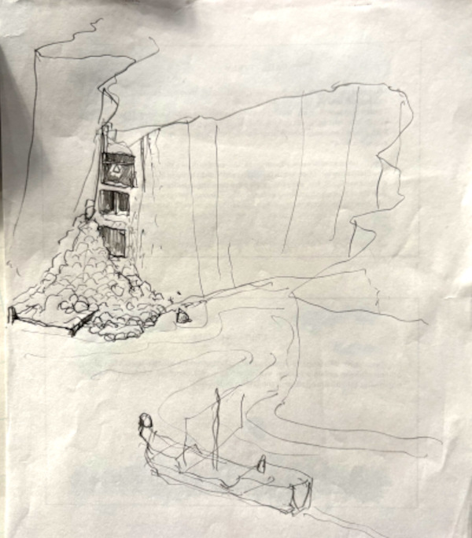

# 2. Aavikon Ruusu
{: .no_toc }

*30. Ches – 7. Tarsakh 1491*
{: .fs-5 .text-grey-dk-000 }

Sisältö

{: .text-delta }
1. TOC
{:toc}

## Yartar

**30. Ches.** Matkalla Yartariin seurue joutui väijytykseen. Kaupungissa oli kaksi majataloa, joihin seurue tutustui: rähjäinen **Juopunut Lohi** ja siistimpi **Pappi & Kirjuri**.

Seurue kysyi Vesiparonin salissa jokilaivaa etelään. ***Aavikon Ruusu*** oli lähtövalmis, ja sen miehistö oli Gilille tuttua. Perämies **Kriphis Maphet**, kapteenin vaimon sisko, kertoi kuitenkin, että kapteeni oli kadonnut.

Yöllä Horna tapasi vanhat tuttunsa **Strikan** ja **Kodan**, jotka kuuluivat Yartarin varaskiltaan **Keltaiseen Käteen**. He kertoivat, mistä *Aavikon Ruusun* kapteeni **Milod Frezim** löytyisi. Häntä pidettiin vankina uhkapelivelkojen takia.

## Jokimatka

**1. Tarsakh.** Malleus voitti kapteenin vapaaksi areenataistelussa, ja *Aavikon Ruusu* lähti matkaan samana päivänä. Laivalla juhlittiin **Rhogarin syntymäpäivää**, ja maljat juotiin juhlallisin menoin.

**2. Tarsakh.** Toinen jokilaiva, ***Jokiviima***, oli ehtinyt lähteä kevään ensimmäisenä. Kevään ensimmäisestä lähdöstä kilpaillaan joella aina kovasti. Nyt *Aavikon Ruusu* löysi sen haaksirikkoutuneena. Laivaan oli hyökätty, ja osa sen miehistöstä oli noussut epäkuolleina. Lasti oli tavallista kauppatavaraa, ja *Aavikon Ruusu* "pelasti" sen itselleen.

**3. Tarsakh.** Joki virtasi solaan, jonka suulla seisoivat **Itkevät Vartijat**, suuret kääpiöpatsaat, joiden silmistä valui vettä. Siellä naamioitunut hahmo vaati *Aavikon Ruusua* luovuttamaan patsaan, jota laiva kuljetti Syvään Veteen. Seurue ja miehistö päättivät luovuttaa patsaan.

{: style="width: 100%; max-width: 320px;" }
*Naamioitunut hahmo*
{: .text-grey-dk-000 }

**4. Tarsakh.** Kanjonissa myrsky riepotteli laivaa. Kanjonin seinämästä oli sortunut pala, ja sortuma oli paljastanut vanhan vartiotornin poikkileikkauksena. Tornista seurue löysi **Besilmerin kellon**.

{: style="width: 100%; max-width: 480px;" }
*Sortuman paljastama vartiotorni Dessarinin kanjonissa*
{: .text-grey-dk-000 }

## Kivisilta

**5. Tarsakh.** Joki kulki peltojen halki **Kivisillalle**, jossa *Aavikon Ruusun* matka päättyi. Sillan luona leiriytyi kauppiaita ja matkalaisia. Vähän kauempana oli toinen leiri, jota vartioivat palkkasoturit. Siellä majaili **Thayn Punaisia velhoja**.

**6. Tarsakh.** Päivä kului leirissä kaupankäynnin merkeissä. Aatelinen **Frath Ammakyl**, Punaisten velhojen "opas", yritti myydä seurueelle hyppy- ja harppaussaappaita.

Yöllä seurue teki ryöstön. Talabriel järjesti heidän pyynnöstään harhautuksen: joesta nousi suuri limademoni ja hyökkäsi leiriin. Sillä välin seurue vei **Rautakruunun**.

## Kryptgarden

**7. Tarsakh.** Seurue pakeni Kryptgardenin metsän laitaan ja leiriytyi sinne. Takaa-ajajat saivat heidät kiinni, mutta seurue taisteli heidät takaisin. Kryptgardenin lehdossa heitä kohtasi **yksisarvinen**, joka paransi Gilin jalassa olleen vanhan vamman.

---

## Henkilöt tässä luvussa

| Nimi | Kuka |
|---|---|
| Milod Frezim | *Aavikon Ruusun* kapteeni. Seurue vapautti hänet uhkapelivelkojen vankeudesta. |
| Kriphis Maphet | *Aavikon Ruusun* perämies, kapteenin vaimon sisko. |
| Strika ja Koda | Keltaisen Käden jäseniä, Hornan vanhoja tuttuja. |
| Frath Ammakyl | Aatelinen, Punaisten velhojen "opas" Kivisillalla. |
| Talabriel | Enkeli, joka järjesti harhautuksen kruunun ryöstöön. |

## Paikat tässä luvussa

| Nimi | Alkuperäinen nimi | Mikä |
|---|---|---|
| Yartar | Yartar | Jokikaupunki, vesiparonin kaupunki. |
| Juopunut Lohi | – | Yartarin majatalo. |
| Pappi & Kirjuri | – | Yartarin siistimpi majatalo. |
| Vesiparonin sali | – | Yartarin vesiparonin sali, jossa sovitaan laivoista. |
| Itkevät Vartijat | – | Kääpiöpatsaat solan suulla. |
| Kivisilta | Stone Bridge | Silta, jonka luona Thayn leiri oli. |
| Syvä Vesi | Waterdeep | Kaupunki, jonne patsasta oli määrä kuljettaa. |
| Kryptgarden | Kryptgarden | Metsä, jonka lehdossa yksisarvinen asui. |
