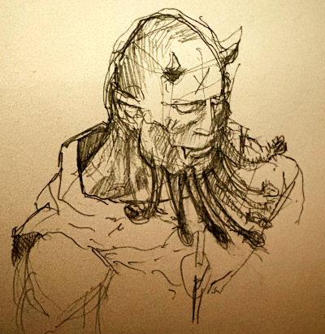
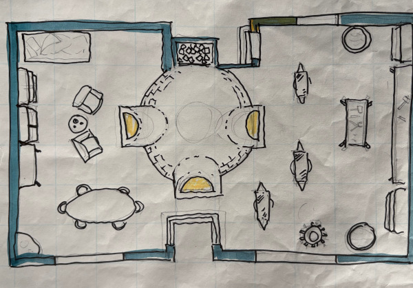

# 3. Sigil
{: .no_toc }

*8.–13. Tarsakh 1491*
{: .fs-5 .text-grey-dk-000 }

Sisältö

{: .text-delta }
1. TOC
{:toc}

## Mustan Kotkan kallio

**8. Tarsakh.** Mustan Kotkan kalliolla, tien varrella Mere of Dead Menin suon laidalla, seuruetta odotti **Talabriel**. Hänen seurassaan olivat ihmismaagi **Kishori** ja haltiametsänkävijä **Ava**.

**9. Tarsakh.** Suolla seurue taisteli peikkoa ja worgia vastaan. **Iniarvin tornissa** suon keskellä he joivat **Matkalaisen viiniä**, ja viini avasi heille portin **Sigiliin**, Ovien kaupunkiin. Malleus joi pullon tyhjäksi, joten kukaan ei tiennyt, miten sieltä pääsisi takaisin.

## Ovien kaupunki

{: style="width: 100%; max-width: 360px;" }
*Basun Ranik, demoniseppä*
{: .text-grey-dk-000 }

Sigilissä katulapsi **Inkid** vei seurueen demoniseppä **Basun Ranikin** luo. Basun lupasi auttaa, mutta tarvitsi siihen **shadar-kai-prinssin kyyneleitä**.

{: style="width: 100%; max-width: 560px;" }
*Basun Ranikin paja*
{: .text-grey-dk-000 }
 Seurue voitti **nagan** ja vei sen sydämen **Gastrognome**-ravintolaan, jota pitää **Celci Nugglebelly**.

**10. Tarsakh.** Gastrognomen tarjoilijoiksi pukeutuneina seurue pääsi **Ceshelonin huoneen** linnoitukseen. Shadar-kai-suku juhli siellä nuorimman lapsensa, prinssi **Lawinin**, syntymäpäivää. Juhlissa prinssi myrkytettiin vahingossa kuoliaaksi. Rhogar toi hänet takaisin valenimellä **Kramvor Itäläinen**. Pelastuksen tiimellyksessä seurue keräsi prinssin kyyneleet kenenkään huomaamatta.

**11. Tarsakh.** Tulijättiläisten **Suuresta Ahjosta** Horna varasti hämähäkiksi muuttuneena **Murtamisen taltan**.

**12. Tarsakh.** Ruumishuoneelta seurue vei **Sielulyhdyn** Tomun Airuiden hallusta. Samana päivänä Gil täytti **35 vuotta**. Hetken hän myös makasi loitsun voimasta näennäisesti kuolleena.

Basun Ranik oli velkojen takia joutunut **hämähäkkijengin** vangiksi. Jengissä oli jättiläishämähäkkejä ja ettercappeja. Seurue pelasti hänet, ja siitä lähtien Basun on kulkenut heidän mukanaan.

## Pronssiportti

**13. Tarsakh.** Rautakruunu murrettiin Murtamisen taltalla. Kruunuun sidottu henkiarmeija vapautui, ja Sielulyhty ohjasi sen tuonpuoleiseen. Teko suututti **Kivun Valtiattaren**, ja seurue pakeni portista, jonka kruunun murtuminen avasi.

Portti vei heidät **Pronssiportin sisäpuolelle**. Valtaistuimella istui muinainen soturikuningas, yllään musta puolilevyhaarniska, jossa oli kotkan tunnus. Seinät olivat täynnä hautalokeroita. Niissä lepäävistä sotureista olisi noussut Pronssiportin armeija, ja Rautakruunu olisi komentanut sitä. Portin toisella puolella odotti ghouleja, joten seurue etsi tiensä syvemmälle hautakammion uumeniin.

---

## Henkilöt tässä luvussa

| Nimi | Kuka |
|---|---|
| Talabriel | Enkeli, seurueen toimeksiantaja. |
| Kishori | Ihmismaagi, Talabrielin seuralainen. |
| Ava | Haltiametsänkävijä, Talabrielin seuralainen. |
| Inkid | Sigilin katulapsi. |
| Celci Nugglebelly | Gastrognome-ravintolan pitäjä Sigilissä. |
| Basun Ranik | Demoniseppä, jonka apua seurue tarvitsi Rautakruunun murtamiseen. Kulkee seurueen mukana. |
| Ceshelonin huone | Shadar-kai-suku: kauppaparoni Ivon, paronitar Iza (soturi) sekä lapset Eren, Rona ja Lawin. |

## Paikat tässä luvussa

| Nimi | Alkuperäinen nimi | Mikä |
|---|---|---|
| Mustan Kotkan kallio | – | Kallio tien varrella suon laidalla. |
| Mere of Dead Men | Mere of Dead Men | Suuri suo rannikolla. |
| Iniarvin torni | Iniarv's Tower | Rauniotorni suolla, jossa Matkalaisen viini juotiin. |
| Sigil | Sigil | Ovien kaupunki, Kivun Valtiattaren kaupunki. |
| Gastrognome | – | Celci Nugglebellyn ravintola Sigilissä. |
| Suuri Ahjo | – | Tulijättiläisten paja Sigilissä. |
| Ruumishuone | The Mortuary | Tomun Airuiden päämaja Sigilissä. |
| Pronssiportti | – | Hautakammio Uumenalassa, kuninkaan ja hänen armeijansa lepopaikka. |
