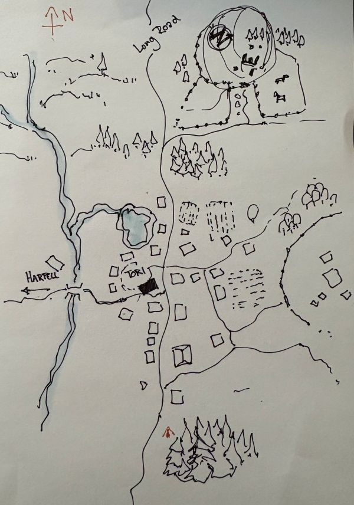
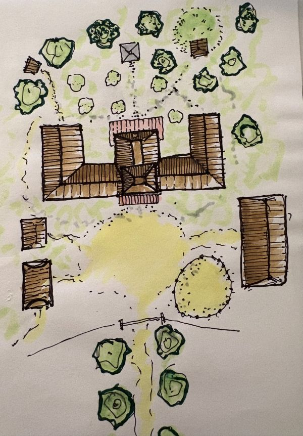

# 5. Kolmikarjun taistelu
{: .no_toc }

*23. Tarsakh – Vihreän ruohon juhla 1491*
{: .fs-5 .text-grey-dk-000 }

Sisältö

{: .text-delta }
1. TOC
{:toc}

## Kultainen Hevosenkenkä

{: style="width: 100%; max-width: 480px;" }
*Pitkäsatula*
{: .text-grey-dk-000 }

**22.–23. Tarsakh.** Pitkässäsatulassa Malleus löysi Kultaisesta Hevosenkengästä ensimmäiseksi baaritiskin. Paikalle saapui joukko Lathanderin seuraajiksi esittäytyviä, ja heidän joukossaan oli vuorikääpiö. Tavernan takana oli sauna ja olutta, joten Malleus ja kääpiö vetäytyivät sinne.

Sillä välin Gil yritti värvätä lathanderilaisia avuksi taisteluun epäkuollutta lohikäärmettä vastaan. He suostuivat, mutta tuntuivat olevan erityisen kiinnostuneita seurueen pirullisemmista jäsenistä. Gil päätti, että seurue majoittuisi Uumenalasta pelastetun Alvinin suvun hevostilalle, ja Alvinille lähetettiin sana.

Matkalla saunaan Malleus oli huomannut kääpiön kyljessä **petturin polttomerkin**. Saunan lauteilla hän yritti kysellä merkistä vaivihkaa, mutta kysymys tuli niin suoraan, että siitä seurasi tappelu. Pienen kahinan, taktisen *hold person* -loitsun ja tajuttomaksi hakkaamisen jälkeen Malleus jatkoi saunomista, nyt lauteeseen sidotun saunakaverin kanssa. Polttomerkin tarina jäi silti arvoitukseksi, ja kääpiö tuntui salaavan muutakin.

Kun Horna ja Basun saapuivat kylään, tavernan ovella oli vähällä syttyä verinen kahakka: lathanderilaiset eivät olleetkaan niin hyväntahtoisia kuin olivat vakuutelleet. Gil sai lopulta Rhogarin avulla suostuteltua heidät siihen, etteivät seurueen pirut olleet taistelun arvoisia. Juhlatunnelma oli kuitenkin mennyttä, ja seurue siirtyi yöksi **Zellorgoszien hevostilalle** metsänlaitaan. Alvinin suku on Pitkänsatulan tunnettuja hevoskasvattajia. Tilan väki epäili, että puheet Lathanderista olivat valetta. Seurue sopi vahtivuoroista ja pyysi isäntää lisäämään vartiointia.

## Yö hevostilalla

{: style="width: 100%; max-width: 480px;" }
*Zellorgoszien tila*
{: .text-grey-dk-000 }

**Yöllä 23.–24. Tarsakh.** Malleus vartioi vankia viinikellarissa ja samalla viiniä, ettei se päätyisi vääriin suihin. Hornan vahtivuorolla talosta kuului ääniä. Horna muuttui pikkueläimeksi ja lähti tutkimaan. Käytävällä kulki palvelija **Abram**, mutta hän liikkui epävarmasti kuin talo olisi ollut hänelle vieras. Horna seurasi häntä isännän huoneeseen ja näki, kuinka palvelija muuttui *Hornan* näköiseksi.

Horna puuttui heti tilanteeseen. Hän lamautti tunkeilijan ja purki tämän taian. Valhehahmon alta paljastui keski-ikäinen mies lathanderilaisten joukosta. Mies pääsi kuitenkin pakoon köysistään jollakin taikuudella. Oikea Abram löytyi talosta kuolleena.

## Palava majatalo

**24. Tarsakh.** Seurue päätti iskeä ensin. Kun he saapuivat majatalolle, se oli tulessa, ja paikalla olleet kyläläiset syyttivät tuhotyöstä seuruetta. Rhogar nosti esiin Kelemvorin symbolin ja puhui väelle järkeä. Silloin palavasta majatalosta hyökkäsi ulos väärä Rhogar, väärä Malleus ja muita roistoja. Seuranneessa taistelussa Malleus hakkasi roistoja minkä ehti.

Taistelun jälkeen paikalle saapui velho **Duncan Harpell**, ja hänellekin piti todistaa, ettei seurueessa ollut mitään vikaa. Valepaladiinien johtaja **Hubbard** jäi henkiin. Hän myönsi, että joukko oli **Thayn Punaisten velhojen palkkaamia palkkionmetsästäjiä**: velhot olivat julkaisseet seurueesta **etsintäkuulutukset**. Hubbard lupasi unohtaa palkkion ja pysyä poissa seurueen tieltä.

Kultistivanki **Jukhur Cumur** oli päättänyt hylätä Lohikäärmekultin aatteen, ja hänet päästettiin vapaaksi. Demoniseppä **Basun Ranik** sai hevostilalta työtarjouksen ja jäi sinne sepäksi.

**25.–26. Tarsakh.** Lepoa ja matkaa kohti Kolmikarjua.

## Kolmikarju valmistautuu

**27. Tarsakh.** Kolmikarjussa selvisi, että **Lohikäärmekultti** oli **Bethrek Mahtavan** johdolla ja Gezzogin avulla miehittänyt **Länsisillan**. Kolmikarju valmistautui taisteluun. Seurue tapasi **Crotherin**, soturin, joka on Kolmikarjun Lady Protectorin **Daratha Shendrelin** oikea käsi. Seurue haki myös **Thaddeus Bromin** ja **Zedin** vankkurit aukiolta, jota koboldit vartioivat.

**28. Tarsakh.** Seurue matkasi **Gwaeron's Restin** pyhättöön ja jätti sinne viestin **Hiljaiselle Sateelle**, haltiapalkkasotureille, joita pyydettiin Kolmikarjun avuksi. Pyhätössä oli kaksi ogrevelhoa, jotka tappoivat seurueen hevoset. Taistelun jälkeen Horna sai **kuusirpin** ja Rhogar **hurskaan amuletin**.

## Kolmikarjun taistelu

**29. Tarsakh.** Hyökkäys alkoi sumulla. Vale-Gezzog iski pakolaisleiriin, ja kaupunkiin hyökkäsi jättiapinoita, joita seurue torjui. Lopulta seurue kohtasi **Gezzogin** **Ikiwyvernin salin** katolla ja pihamaalla. Gezzogin rinnalla taisteli lohikäärmesyntyinen nainen, jonka Rhogar tunnisti: hänen siskonsa **Rhoanna**. Gezzog ja Rhoanna ryöstivät suuren **sinisen safiirin**, jonka zhentiläinen kreivi **Darak Thorne** oli tarjonnut Lady Protectorille "myötäjäisiksi".

**30. Tarsakh.** Kaupungissa siivottiin taistelun jälkiä. Kultti vetäytyi Länsisillalle. Yöllä Rhogar paransi sairaita.

## Vihreän ruohon juhla

Kolmikarju juhli voittoa ja suri kuolleitaan. Lady Protector otti seurueen vastaan, ja hänen seurassaan oli Hiljaisen Sateen puolihaltia **Sharat**. Hiljainen Sade ei sopimussyistä voinut auttaa. Lady Protector antoi seurueelle **neljä hopeista solkea**, **Kolmikarjun Vartijan Soljet**, jotka hohtavat yhtä aikaa. Niissä lukee: *"Yhdessä olette linnoitus."*

Seurue keskusteli Länsisillan tilanteesta puolituisen **Herivinin** kanssa. Hän on Länsisillan majatalon isäntä. Hyökkäystä oli johtanut kultisti, jolla oli keltainen viitta, valkoiset naamiot ja kultainen arpi: **Bethrek Mahtava** itse. Kultistit etsivät **Kolmen valtiattaren triptyykkiä** ja olivat jostain syystä patsaiden perässä. Kultin metsäleiri oli Kryptgardenissa.

Thaddeus tunsi kivenhakkaaja **Horgarin**, joka tuntee Kryptgardenin hyvin. Seurue sai selville Horgarin asuinpaikan Länsisillalla sekä salareitin Herivinin majataloon. Thaddeus lähti etsimään hapolta suojaavia juomia. Niitä hän ei löytänyt, mutta toi vedessähengitysjuoman ja ansojen löytämisen käärön.

> **Kolmikarjun Vartijan Solki** (ihmeesine, vaatii virittäytymisen). Soljet voimistuvat sitä mukaa, mitä useampi virittäytynyt kantaja on 30 jalan sisällä toisistaan. Voimat kertyvät:
>
> | Kantajia yhdessä | Voima | Hyöty |
> |---|---|---|
> | 1 tai enemmän | **Yksinäinen vartija** | Kantaja voi loitsia *alarm*-loitsun (vain rituaalina) ja *detect poison and disease* -loitsun rajattomasti. |
> | 2 tai enemmän | **Vartijapari** | +1 aloitteeseen. Kantajaa ei voi yllättää, kun toinen kantaja 30 jalan sisällä ei ole toimintakyvytön. |
> | 3 tai enemmän | **Kilpimuuri** | Kun toiseen kantajaan 5 jalan sisällä kohdistetaan hyökkäys, kantaja voi reaktiollaan antaa tälle +2 AC:hen. |
> | 4 | **Yhtenäinen rintama** | Kerran pitkän levon aikana ryhmä voi herättää **Jaetun näön**: 10 minuutin ajan kaikilla neljällä on 60 jalan pimeänäkö, ja he voivat puhua toisilleen telepaattisesti mailin päähän. |

---

## Henkilöt tässä luvussa

| Nimi | Kuka |
|---|---|
| Alvin Zellorgosz ja suku | Pitkänsatulan hevoskasvattajasuku. Alvin pelastettiin Uumenalasta. |
| Abram | Hevostilan palvelija, jonka hahmonvaihtaja surmasi. |
| Hubbard | Valepaladiinien johtaja, Thayn palkkaama palkkionmetsästäjä. |
| Duncan Harpell | Pitkänsatulan velho. |
| Jukhur Cumur | Kultistivanki, joka hylkäsi kultin ja päästettiin vapaaksi. |
| Basun Ranik | Demoniseppä, jäi Zellorgoszien tilalle sepäksi. |
| Bethrek Mahtava | Lohikäärmekultin johtaja Länsisillalla. |
| Daratha Shendrel | Kolmikarjun Lady Protector. |
| Crother | Soturi, Lady Protectorin oikea käsi. |
| Thaddeus Brom ja Zed | Talabrielin yhteyshenkilöt, kauppias ja goliath-vartija. |
| Sharat | Hiljaisen Sateen edustaja, puolihaltia. |
| Rhoanna | Rhogarin sisko, taisteli Gezzogin rinnalla. |
| Darak Thorne | Zhentiläinen kreivi, joka tarjosi Lady Protectorille sinistä safiiria. |
| Herivin | Puolituinen, Länsisillan majatalon isäntä. |
| Horgar | Kivenhakkaaja, joka tuntee Kryptgardenin. |

## Paikat tässä luvussa

| Nimi | Alkuperäinen nimi | Mikä |
|---|---|---|
| Pitkäsatula | Longsaddle | Kylä, Harpellien koti. |
| Kultainen Hevosenkenkä | – | Pitkänsatulan majatalo. |
| Zellorgoszien tila | – | Hevostila Pitkänsatulan metsänlaidassa ("Ranch Z"). |
| Kolmikarju | Triboar | Kaupunki, jonka kultti yritti vallata. |
| Länsisilta | Westbridge | Kultin miehittämä kylä. |
| Gwaeron's Rest | Gwaeron's Rest | Pyhättö lähellä Kolmikarjua. |
| Ikiwyvernin sali | Everwyvern | Kolmikarjun rakennus, jonka katolla Gezzog kohdattiin. |
| Kryptgarden | Kryptgarden | Metsä, jossa kultin leiri oli. |
