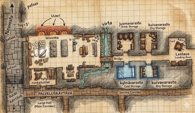

# 7. Mirabar
{: .no_toc }

*5.–15. Mirtul 1491*
{: .fs-5 .text-grey-dk-000 }

Sisältö

{: .text-delta }
1. TOC
{:toc}

## Talabrielin viesti

**5. Mirtul.** Talabrielin pyynnöstä seurue tapasi hänet Pitkässäsatulassa. Talabriel kertoi heille **sielukivistä** ja suunnitelmasta iskeä **samanaikaisesti Thayssa ja Amphailissa**. Hän korosti, kuinka tärkeitä **Sielulyhty** ja **Murtamisen taltta** ovat. Seurue lähti kuitenkin ensin pohjoiseen kohti **Mirabaria** palauttamaan Besilmerin kellon kääpiöklaaneille.

## Xantharlin linnoitus

**6. Mirtul.** Puolenpäivän aikaan seurue saapui **Xantharlin linnoitukseen**, pieneen kylään Mirabarin tien varrella. Kylän vartijat olivat vanginneet Myrskyliskon heimon jäseniä, heidän joukossaan Uumenalasta pelastetun **Anthoksen**. Heimo vapautti heidät yöllä. Seurue auttoi heimon shamaania **kivipaasilla** karkottamaan henkiä.

Rhoanna oli jäänyt Pitkäänsatulaan. Kun Rhogar lähetti hänelle viestin taikuudella, Rhoanna vastasi ostaneensa aasin ja lähteneensä etelään.

**7. Mirtul.** Matkapäivä.

## Kellon paluu

**8. Mirtul.** Puoliltapäivin seurue saapui **Mirabariin**. Siellä se tapasi kaupungin kääpiöjohtajia: Mirabarin kirveiden komentajan **Morana Rautakouran**, Moradinin ylipapin **Olunt Daerdahkin**, Vergadainin papin **Riswynn Kullanlöytäjän** ja Dumathoinin papin **Whurbin Hopeakiven**. Paikalla olivat myös apupapit **Nuraval Gorunn** ja **Liftrasa Väkiahjo**.

Yöllä tehtiin kellon palautusrituaali. **Kellon henget ja kellomestari pääsivät viimein lepoon.**

## Succubus

{: style="width: 100%; max-width: 560px;" }
*Keittiö, jossa succubus yllätettiin*
{: .text-grey-dk-000 }

**9. Mirtul.** Kääpiöt maksoivat seurueelle palkkiot. Riswynn oli kuitenkin herättänyt epäilyjä, ja illalla hän paljastui **succubukseksi**. Seurue houkutteli hänet keittiöön persikoilla, yllätti hänet siellä ja voitti hänet.

**10. Mirtul.** Mirabarin maanalaisten kaivosten **Kristalliputoukselta** matka jatkui katakombeihin. Sieltä löytyi noiduttuna **oikea Riswynn**, ja seurue pelasti hänet. Riswynn kertoi joutuneensa lumotuksi ja vaipuneensa koomaan. Seurue arveli, että succubus oli jättänyt hänet henkiin voidakseen myöhemmin palauttaa hänet temppeliin.

Kiitokseksi seurue sai näkymättömyys- ja haavoittumattomuusjuomat sekä **Vergadainin mitalit**, joilla he voivat osoittaa olevansa Vergadainin pappien ystäviä.

## Paluu etelään

**11. Mirtul.** Seurue lähti etelään pitkin Pitkää tietä. Seuraava tavoite oli käydä Gilin kotikylässä ennen Amphailiin menoa.

**12. Mirtul.** Yö Xantharlin linnoituksessa.

**13. Mirtul.** Matkapäivä.

**14. Mirtul.** Yö Pitkänsatulan Kultaisessa Hevosenkengässä. Siellä seurue kuuli, että Rhoanna oli lähtenyt kylästä etelään.

**15. Mirtul.** Matkapäivä.

---

## Henkilöt tässä luvussa

| Nimi | Kuka |
|---|---|
| Talabriel | Enkeli, joka kertoi seurueelle sielukivistä. |
| Anthos | Myrskyliskon heimon barbaari, jonka Xantharlin vartijat vangitsivat. |
| Morana Rautakoura | Mirabarin kirveiden komentaja. |
| Olunt Daerdahk | Moradinin ylipappi. |
| Riswynn Kullanlöytäjä | Vergadainin pappi, jonka paikan succubus oli vienyt. |
| Whurbin Hopeakivi | Dumathoinin pappi. |
| Nuraval Gorunn | Apupappi, hopeakääty. |
| Liftrasa Väkiahjo | Apupappi, pronssikääty. |

## Paikat tässä luvussa

| Nimi | Alkuperäinen nimi | Mikä |
|---|---|---|
| Xantharlin linnoitus | Xantharl's Keep | Pieni kylä Mirabarin tien varrella. |
| Mirabar | Mirabar | Kääpiöiden ja ihmisten kaivoskaupunki pohjoisessa. |
| Kristalliputous | – | Paikka Mirabarin maanalaisissa kaivoksissa. |
| Pitkä tie | Long Road | Tie Mirabarista etelään. |
