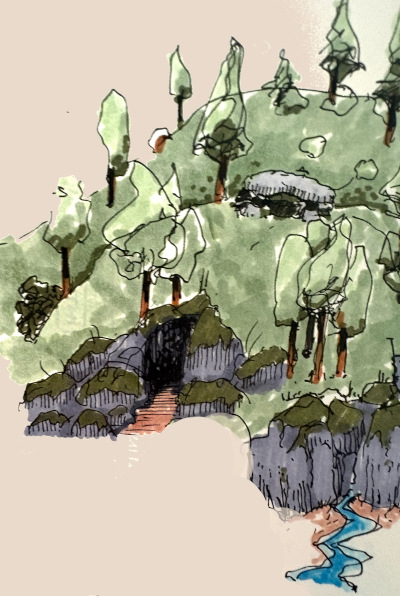

# 8. Gilin koti
{: .no_toc }

*16.–21. Mirtul 1491*
{: .fs-5 .text-grey-dk-000 }

Sisältö

{: .text-delta }
1. TOC
{:toc}

## Rhoanna

**16. Mirtul.** Ennen Kolmikarjua seurue kohtasi karavaanareita. He kertoivat, että lohikäärmesyntyinen nainen oli vapauttanut kultisteja Kolmikarjussa ja että yksi vartija oli kuollut. Nainen oli sanonut vapauttavansa sukulaisiaan.

Kolmikarjussa selvisi, että **Crother** oli kuollut **Rhoannan** puhaltamaan myrkkypilveen. Kuolemasta oli kulunut alle kymmenen päivää, joten **Rhogar herätti hänet kuolleista**. Rhoanna ja kultistit olivat menneet etelään läheiselle rämeelle.

**17. Mirtul.** Horna katsoi taikuudella, miltä Rhoannan olinpaikassa näytti, ja opas vei seurueen **Mustakidan rämeelle**. Seurue saapui paikalle pöllöillä, mutta tiheä metsä haittasi lentämistä. Rämeeltä löytyi kuollut kultisti, ja sitten seurue taisteli kahta suurta hämähäkkiä vastaan.

Rhoanna löytyi sekavana. Malleus onnistui rauhoittamaan hänet, eikä myrkkypilviä enää lentänyt. Rhogar arvioi, että Rhoanna kärsi koettelemustensa jäljistä. Seurue paransi hänet taikuudella ja päätti saattaa hänet **Nicran luostariin**.

Aamuyöllä leiriin saapui Oghman pappi **Tamas Bokhart**. Hän oli hyvin kiinnostunut seurueen teoista. Hän kertoi, että Kivisilta oli autioitunut *Aavikon Ruusun* kirouksen takia ja että siellä kummitteli. Seurue päätti kulkea Kivisillan kautta, sillä sitä kautta pääsi myös Gilin kotikylään.

## Kivisilta

**18. Mirtul.** Kivisillalla seurue vapautti ***Aavikon Ruusun* miehistön kirotut henget**. Illalla seurue saapui **Beliardin** kylään. Kyläläiset kertoivat mäkijättiläisten aiheuttamasta harmista, mutta seurue oli tärkeällä tehtävällä eikä ehtinyt auttaa.

## Poltettu tila

**19. Mirtul.** Rhoanna lähti Beliardista yksin länteen. Seurue jatkoi **Gilin kotitilalle**. Tila oli poltettu.

"Naapuri" yritti saada Gilin ottamaan itselleen **Mustan hilparin**. Gil otti aseen, mutta tajusi naapurin todellisen luonteen: tämä oli **paholainen**. Gil surmasi sen.

Gilin vanhemmat **Romy** ja **Martha** oli tapettu ja nostettu epäkuolleiksi. Seurue antoi heille rauhan ja siunasi heidän henkensä. Gilin veli **Ronn** oli kadonnut.

## Musta hilpari

**20. Mirtul.** Louhikosken majatalon tarjoilija kertoi, että **Ronn oli lähtenyt kostoretkelle kohti Amphailia**. Matkalla Louhikoskelta kohti Lautanrakentajan majataloa Gil heitti Mustan hilparin sillalta Dessariniin.

Yöllä seurueen kimppuun hyökkäsi joukko naamioituneita rosvoja ja salamurhaajia, jotka olivat riivanneet Louhikosken seutua. Taistelussa Gil huomasi, ettei pystynyt kunnolla käyttämään muita aseita: hilpari oli kironnut hänet. Hilpari noudettiin joesta ja kirous poistettiin. Musta hilpari on yhä Gilillä.

## Leroyn luola

{: style="width: 100%; max-width: 400px;" }
*Leroyn luola*
{: .text-grey-dk-000 }

**21. Mirtul.** Kuolleilta rosvoilta seurue oli saanut *speak with dead* -loitsulla selville, missä rosvojen piilopaikka suunnilleen oli. Metsästäjä **Ekemon**, joka tunsi Louhikosken eteläpuolisen metsän, opasti heidät sinne. **Leroyn luolasta** löytyi naamioituneiden rosvojen joukko. Rosvot olivat toimineet Thayn palveluksessa ja kostaneet seurueelle. Seurue surmasi heidät, ja osa "rosvoista" paljastui valepukuisiksi **Thayn Punaisiksi velhoiksi**. Gil oli kostanut vanhempiensa kuoleman. Ronnia ei luolassa ollut.

Luola ja rosvojoukko olivat kerran kuuluneet lainsuojattomalle **Leroylle**. Luolasta löytyi Leroy itse **kivettyneenä**. Seurue palautti hänet lihaksi ja vereksi, ja hän keskusteli heidän kanssaan. Hän näytti seurueelle **pakoavaimensa**, käytti sitä kerran näyttääkseen, miten se toimii, ja jätti sen heille. Sitten hän lähti Louhikoskelle aloittamaan elämänsä alusta uudella nimellä: **"Roley"**.

Thayn saaliista seurue otti talteen **rannerenkaan, jossa oli Thayn riimuja**, **punaisen silkkihunnun** ja **tumman lasiastian**. Nuori rosvo **Malark Evenwood** päästettiin pakoon, kun hän oli vannonut pysyvänsä kaidalla tiellä. Ilta kului levossa.

---

## Henkilöt tässä luvussa

| Nimi | Kuka |
|---|---|
| Crother | Lady Protectorin oikea käsi. Rhogar herätti hänet kuolleista. |
| Rhoanna | Rhogarin sisko. Lähti kohti Nicran luostaria. |
| Tamas Bokhart | Oghman pappi, joka kertoi Kivisillan kirouksesta. |
| Romy ja Martha | Gilin vanhemmat. |
| Ronn | Gilin veli, lähti kostoretkelle kohti Amphailia. |
| Ekemon | Louhikosken metsästäjä. |
| Leroy ("Roley") | Lainsuojaton, jonka luola ja joukko kerran olivat. Seurue palautti hänet kivettyneestä. Jätti seurueelle pakoavaimensa ja aloitti uuden elämän Louhikoskella. |
| Malark Evenwood | Nuori rosvo, joka päästettiin pakoon. |

## Paikat tässä luvussa

| Nimi | Alkuperäinen nimi | Mikä |
|---|---|---|
| Mustakidan räme | Black Maw Bog | Räme Kolmikarjun eteläpuolella. |
| Nicran luostari | – | Luostari, jossa Rhoanna toipuu. |
| Kivisilta | Stone Bridge | Silta, jossa *Aavikon Ruusun* miehistö kummitteli. |
| Beliard | Beliard | Kylä, jota mäkijättiläiset kiusaavat. |
| Louhikoski | Womford | Kylä Dessarinin varrella. |
| Lautanrakentajan majatalo | Bargewright Inn | Majatalokylä Dessarinin länsirannalla. |
| Leroyn luola | – | Rosvojen piilopaikka Louhikosken eteläpuolisessa metsässä. |
